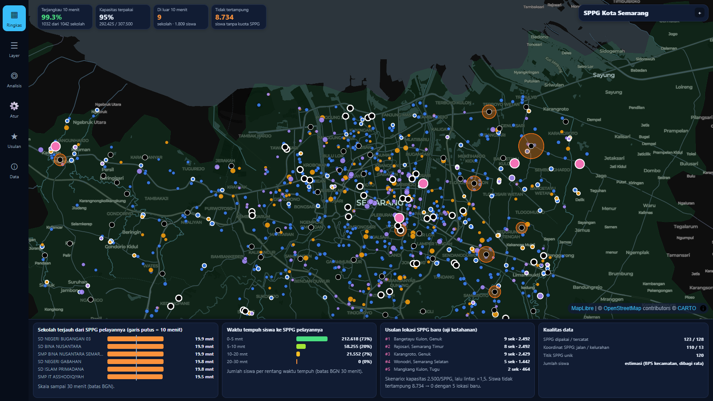

# WebGIS SPPG Semarang City

How many schools in Semarang are still out of reach of a nutrition kitchen? This WebGIS dashboard answers that question for the city's SPPG kitchens (Satuan Pelayanan Pemenuhan Gizi, the units that cook daily meals for the free school meal program): **do they reach the schools around them with enough capacity, and where would a new kitchen help the most?**

**Live demo:** https://arsyadika.github.io/Arsya-Dika_WEBGIS_SPPG_Final-Project/


## Key findings

Using the official BGN rules applied in this project (at most 3,000 meals per SPPG per day and a maximum travel time of 30 minutes):

| Measure | Result |
|---|---|
| Students whose school is within a 10-minute drive of at least one SPPG | **99.3%** (1,032 of 1,042 schools) |
| Citywide capacity in use | **79%** (292,425 of 369,000 meals per day) |
| Students not covered by any SPPG quota within 30 minutes | **0** |
| Schools outside the 10-minute area of every SPPG | **10 schools** (2,070 students) |
| New SPPG sites required under BGN rules | **0** (every student is covered within 30 minutes) |
| Stress test: real capacity of 2,500, normal traffic | 2,365 students not covered; **1 new site** closes the gap |
| Stress test: real capacity of 2,500, morning traffic ×1.5 | 8,734 students not covered; **5 new sites** close the gap |
| Travel time to the fastest SPPG | median 2.5 min, 90th percentile 5.0 min, maximum 17.4 min |

In short, **under BGN rules Semarang's SPPG network is already sufficient, and no new site has to be built**. The 10-minute threshold is an internal benchmark, stricter than the BGN limit of 20–30 minutes; ten schools on the city's edge fall outside it, but none is more than 17.4 minutes from its nearest SPPG.

New site proposals therefore come from a **stress test**, not from the baseline rules: would every student still be served if the real capacity of each SPPG were below 3,000, and if morning traffic slowed deliveries down (travel time multiplied by 1.25, 1.5 or 2)? Pick a scenario in the Settings menu; proposed sites appear only when that scenario leaves students uncovered. The traffic factor is a simple multiplier, not real congestion data (ORS travel times do not include traffic).

A note on allocation: a full SPPG passes schools on to the next nearest SPPG, so some schools are served by a kitchen that is not their fastest one. The average student travel time is 3.5 minutes, but 38 schools are served by an SPPG more than 10 minutes away (the longest is 23 minutes, still under 30).



*Example stress-test scenario: real capacity of 2,500 per SPPG and morning traffic ×1.5; the pink dots are the 5 proposed sites.*

## Features

- **Easy for first-time visitors**: an intro card stating the question being answered, a permanent legend, automatic key findings and a 5-step tour. The layout also adapts to phone screens.
- A map of schools (primary, junior high and senior/vocational high; madrasahs have a white outline) and black SPPG points, on dark, street and satellite basemaps. Point size follows student numbers and zoom level.
- **Dynamic coverage areas (isochrones)**: a 1–10 minute travel-time slider built on multi-interval data, with no API calls from the browser.
- **Capacity-aware allocation based on travel time**: SPPG–school pairs are processed from the shortest travel time up; each SPPG takes its nearest schools until its daily quota of 3,000 is full, then the remaining schools go to the next nearest SPPG that still has capacity, all within 30 minutes.
- **New SPPG proposals (stress test)**: scenario pickers for real capacity (2,000 / 2,500 / 3,000) and morning traffic (normal / ×1.25 / ×1.5 / ×2). A greedy search over 150 candidate sites, scored on travel time and capacity, with the reasoning for each site; the smallest number of sites that covers every unserved student is shown automatically.
- A city summary dashboard: four key figures, the schools farthest from their serving SPPG, the distribution of student travel times (0–5, 5–10, 10–20, 20–30 minutes), a list of proposed new SPPG sites (click a row to zoom to it) and data quality notes.

## How it works

1. **School data**: the official list of Semarang City schools (NPSN ID and coordinates) from the Ministry of Primary and Secondary Education (Kemendikdasmen) reference data.
2. **Student numbers**: per-district (kecamatan) enrolment tables from BPS *Kota Semarang Dalam Angka 2026* (2025/2026 school year), split evenly across schools in the same group (level, district, public/private).
3. **SPPG locations**: coordinates were improved step by step (village-level geocoding, then street-name lookup in OpenStreetMap via Overpass) and flagged for whether they are used in the analysis.
4. **Travel time**: 1–10 minute isochrones, an SPPG-to-school matrix and a candidate-to-school matrix were calculated with OpenRouteService (driving profile) and saved as static files.
5. **The app** loads those static files and calculates coverage, allocation and candidates right in the browser (MapLibre GL JS, Turf.js, Chart.js). There is no server and no API key on the browser side.

## Data limitations (please read before using the numbers)

- **Student numbers are estimates.** BPS only publishes figures per district, so students are split evenly across schools. Large and small schools are treated the same.
- **Capacity and reach follow BGN guidance that has not yet been checked against the official documents.** The 3,000 meals per SPPG per day and the 20–30 minute limit come from news coverage and a copy of the technical guidelines. Scenarios of 2,000 and 2,500 are available in the Settings tab; at 2,000, about 50,000 students are not covered, so the sufficiency result depends heavily on the capacity assumption.
- **One student counts as one meal**, and a school is never split across several SPPGs.
- **Not every SPPG location is precise.** Of the 123 SPPGs used (120 unique points): 80 are on a street, 23 on an OSM road segment, 7 at a named place, and **13 are still village-level points** (the OSM lookup failed or could not find the address; 4 of them are in Semarang Regency).
- **School coverage is limited to Semarang City.** A few SPPGs in Semarang Regency (Ungaran) are included because they sit near the border, but schools in the regency are not loaded.
- **The traffic factor is only a simple multiplier** on travel time, not real congestion data. New site proposals depend on the chosen scenario and are most sensitive to the real capacity assumption.
- **Candidates are chosen from 150 possible sites** (school points, at least 1 km apart from each other and 300 m from existing SPPGs), not from the whole city. The results are an early pointer, not a final placement recommendation.
- The SPPG address list comes from a third-party directory (infosppg.id), not from BGN.

## Tech stack

Plain HTML, CSS and JavaScript with no framework; MapLibre GL JS 4.7, Turf.js 7, Chart.js 4.4, Tailwind (CDN). Road and travel-time data: OpenStreetMap and OpenRouteService. Data processing scripts run on Node.js.

## Running locally

This is a static app. Start a local server from the project folder, then open `index.html`:

```
python -m http.server 8000
```

Open http://localhost:8000/index.html (or use the Live Server extension).

### Recalculating the data (optional)

The results are already saved in the `data/` folder, so this step is only needed when SPPG or school locations change. It requires Node.js 18+ and a `.env` file containing `ORS_API_KEY=...` (never committed).

```
node scripts/fetch-isochrones-multi.mjs   # 1-10 minute isochrones for each SPPG point
node scripts/fetch-matriks-waktu.mjs      # SPPG -> school travel times
node scripts/pilih-kandidat.mjs           # pick 150 candidate sites
node scripts/fetch-matriks-kandidat.mjs   # candidate -> school travel times
```

The other scripts in `scripts/` (fetching schools, SPPG addresses, geocoding, parsing BPS tables) are run once while building the data; their order and outputs are explained in the comment at the top of each script.

## Learning log

I built this project while learning. Every fix and decision is recorded as problem, change, reason, result and lesson in [docs/catatan-belajar.md](docs/catatan-belajar.md) (in Indonesian). The commit history follows that log.

## Author

Arsya Dika

------------------

# WebGIS SPPG Kota Semarang

Dashboard WebGIS untuk menjawab satu pertanyaan: **apakah dapur SPPG (Satuan Pelayanan Pemenuhan Gizi) di Kota Semarang sudah menjangkau dan mencukupi sekolah di sekitarnya, dan di mana lokasi SPPG baru paling berguna?**

**Demo:** https://arsyadika.github.io/Arsya-Dika_WEBGIS_SPPG_Final-Project/


## Temuan utama

Dengan aturan resmi BGN yang dipakai proyek ini (maksimal 3.000 porsi per SPPG per hari dan waktu tempuh maksimal 30 menit):

| Ukuran | Hasil |
|---|---|
| Siswa yang sekolahnya berada dalam 10 menit berkendara dari satu SPPG atau lebih | **99,3%** (1.032 dari 1.042 sekolah) |
| Kapasitas terpakai di seluruh kota | **79%** (292.425 dari 369.000 porsi per hari) |
| Siswa yang tidak tertampung kuota SPPG mana pun dalam 30 menit | **0** |
| Sekolah di luar area 10 menit dari SPPG mana pun | **10 sekolah** (2.070 siswa) |
| Lokasi SPPG baru yang diperlukan menurut aturan BGN | **0** (semua siswa tertampung dalam 30 menit) |
| Uji ketahanan: kapasitas riil 2.500, lalu lintas normal | 2.365 siswa tidak tertampung; **1 lokasi baru** menutupnya |
| Uji ketahanan: kapasitas riil 2.500, lalu lintas jam pagi ×1,5 | 8.734 siswa tidak tertampung; **5 lokasi baru** menutupnya |
| Waktu tempuh ke SPPG tercepat | median 2,5 menit, persentil 90 5,0 menit, maksimum 17,4 menit |

Artinya, **menurut aturan BGN jaringan SPPG Kota Semarang sudah mencukupi dan tidak ada lokasi baru yang wajib dibangun**. Batas 10 menit adalah ukuran internal yang lebih ketat dari batas BGN (20–30 menit); sepuluh sekolah di tepi kota berada di luar 10 menit, tetapi tidak ada yang lebih dari 17,4 menit dari SPPG terdekat.

Usulan lokasi baru karena itu dihitung dari **uji ketahanan**, bukan dari aturan dasar: apakah siswa tetap tertampung bila kapasitas riil SPPG lebih kecil dari 3.000 dan bila lalu lintas jam pagi memperlambat pengantaran (waktu tempuh dikali 1,25 / 1,5 / 2). Pilih skenarionya di menu Atur; lokasi usulan muncul hanya bila ada siswa yang tidak tertampung pada skenario itu. Faktor lalu lintas adalah pengali sederhana, bukan data macet nyata (data ORS tanpa lalu lintas).

Catatan alokasi: SPPG yang penuh melepas sekolah ke SPPG terdekat berikutnya, sehingga sebagian sekolah dilayani SPPG yang bukan tercepat. Rata-rata waktu tempuh siswa 3,5 menit, tetapi 38 sekolah dilayani SPPG yang berjarak lebih dari 10 menit (terjauh 23 menit, masih di bawah 30).


*Contoh skenario uji ketahanan: kapasitas riil 2.500 per SPPG dan lalu lintas pagi ×1,5; titik merah muda adalah 5 lokasi usulan.*

## Fitur

- **Mudah dipahami pengunjung baru**: kartu pengantar dengan pertanyaan yang dijawab, legenda permanen, temuan utama otomatis, dan tur 5 langkah. Tampilan juga disesuaikan untuk layar ponsel.
- Peta sekolah (SD/MI, SMP/MTs, SMA/SMK/MA; madrasah berpinggiran putih) dan titik SPPG hitam, dengan basemap gelap, jalan, dan satelit. Ukuran titik mengikuti jumlah siswa dan zoom.
- **Area jangkauan (isochrone) dinamis**: slider waktu tempuh 1–10 menit dari data multi-waktu (tanpa memanggil API dari browser).
- **Alokasi berkapasitas berbasis waktu tempuh**: pasangan SPPG–sekolah diproses dari waktu tempuh terpendek; tiap SPPG mengambil sekolah terdekatnya sampai kuota 3.000 per hari penuh, lalu sisa sekolah diambil SPPG terdekat lain yang masih punya kuota, semuanya maksimal 30 menit.
- **Usulan SPPG baru (uji ketahanan)**: pemilih skenario kapasitas riil (2.000 / 2.500 / 3.000) dan lalu lintas jam pagi (normal / ×1,25 / ×1,5 / ×2). Pencarian serakah dari 150 calon lokasi, dinilai dengan waktu tempuh dan kapasitas, lengkap dengan alasan tiap lokasi; jumlah paling sedikit yang menutup semua siswa yang tidak tertampung tampil otomatis.
- Dashboard ringkasan kota: empat angka kunci, sekolah terjauh dari SPPG pelayannya, sebaran waktu tempuh siswa (0–5, 5–10, 10–20, 20–30 menit), daftar usulan lokasi SPPG baru (klik baris untuk zoom ke lokasinya), dan kualitas data.

## Cara kerja singkat

1. **Data sekolah**: daftar sekolah resmi Kota Semarang (NPSN dan koordinat) dari referensi Kemendikdasmen.
2. **Jumlah siswa**: tabel murid per kecamatan dari BPS *Kota Semarang Dalam Angka 2026* (tahun ajaran 2025/2026), dibagi rata ke sekolah pada kelompok yang sama (jenjang, kecamatan, negeri/swasta).
3. **Titik SPPG**: koordinat diperbaiki bertahap (geocoding kelurahan, lalu pencarian nama jalan di OpenStreetMap lewat Overpass), lalu ditandai mana yang dipakai analisis.
4. **Waktu tempuh**: isochrone 1–10 menit, matriks SPPG ke sekolah, dan matriks calon kandidat ke sekolah dihitung dari OpenRouteService (profil mobil) dan disimpan sebagai berkas statis.
5. **Aplikasi** memuat berkas statis itu dan menghitung cakupan, alokasi, serta kandidat langsung di browser (MapLibre GL JS, Turf.js, Chart.js). Tidak ada server dan tidak ada API key di sisi browser.

## Keterbatasan data (baca sebelum memakai angkanya)

- **Jumlah siswa adalah estimasi.** BPS hanya menyediakan angka per kecamatan, jadi siswa dibagi rata antar sekolah. Sekolah besar dan kecil dianggap sama.
- **Kapasitas dan jangkauan memakai acuan BGN yang belum diverifikasi ulang ke dokumen resminya.** Kapasitas 3.000 per SPPG per hari dan batas 20–30 menit berasal dari pemberitaan dan salinan petunjuk teknis. Skenario 2.000 dan 2.500 tersedia di tab Atur; pada 2.000, sekitar 50.000 siswa tidak tertampung, jadi angka kecukupan sangat bergantung pada asumsi kapasitas.
- **Satu siswa dianggap satu porsi**, dan satu sekolah tidak dipecah ke beberapa SPPG.
- **Titik SPPG tidak seluruhnya presisi.** Dari 123 SPPG yang dipakai (120 titik unik): 80 di jalan, 23 di ruas jalan OSM, 7 di tempat bernama, dan **13 masih berupa titik kelurahan** (pencarian OSM gagal atau tidak menemukan alamatnya; 4 di antaranya di Kabupaten Semarang).
- **Cakupan sekolah hanya Kota Semarang.** Beberapa SPPG di Kabupaten Semarang (Ungaran) ikut dihitung karena dekat perbatasan, tetapi sekolah di kabupaten itu tidak dimuat.
- **Faktor lalu lintas hanya pengali sederhana** pada waktu tempuh, bukan data kemacetan nyata. Usulan lokasi baru bergantung pada skenario yang dipilih dan paling sensitif terhadap asumsi kapasitas riil.
- **Kandidat dipilih dari 150 calon lokasi** (titik sekolah, jarak minimal 1 km antar calon dan 300 m dari SPPG yang ada), bukan dari seluruh kota. Hasilnya petunjuk awal, bukan rekomendasi penempatan final.
- Daftar alamat SPPG berasal dari direktori pihak ketiga (infosppg.id), bukan dari BGN.

## Teknologi

HTML, CSS, JavaScript tanpa kerangka kerja; MapLibre GL JS 4.7, Turf.js 7, Chart.js 4.4, Tailwind (CDN). Data jalan dan waktu tempuh: OpenStreetMap dan OpenRouteService. Skrip pengolah data memakai Node.js.

## Cara menjalankan

Aplikasi statis. Dari folder proyek jalankan server lokal, lalu buka `index.html`:

```
python -m http.server 8000
```

Buka http://localhost:8000/index.html (atau pakai ekstensi Live Server).

### Menghitung ulang data (opsional)

Hasil sudah tersimpan di folder `data/`, jadi langkah ini hanya perlu bila titik SPPG atau sekolah berubah. Butuh Node.js 18+ dan berkas `.env` berisi `ORS_API_KEY=...` (tidak ikut ter-commit).

```
node scripts/fetch-isochrones-multi.mjs   # isochrone 1-10 menit tiap titik SPPG
node scripts/fetch-matriks-waktu.mjs      # waktu tempuh SPPG -> sekolah
node scripts/pilih-kandidat.mjs           # pilih 150 calon lokasi baru
node scripts/fetch-matriks-kandidat.mjs   # waktu tempuh calon -> sekolah
```

Skrip lain di `scripts/` (pengambilan sekolah, alamat SPPG, geocoding, penguraian tabel BPS) dijalankan sekali saat membangun data; urutan dan keluarannya dijelaskan pada komentar di awal tiap skrip.

## Catatan belajar

Proyek ini dikerjakan sambil belajar. Setiap perbaikan dan keputusan dicatat dengan format masalah, perubahan, alasan, hasil, dan pelajaran di [docs/catatan-belajar.md](docs/catatan-belajar.md). Riwayat commit mengikuti catatan itu.

## Author

Arsya Dika
