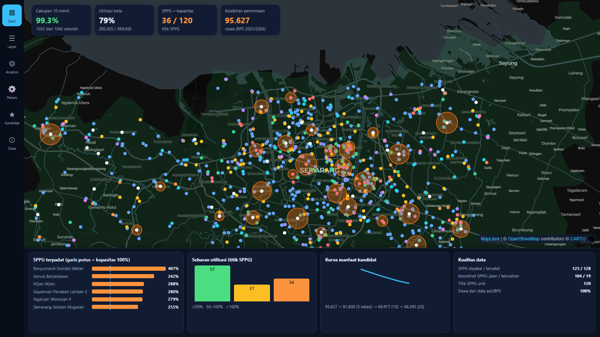

# WebGIS SPPG Kota Semarang

Dashboard WebGIS untuk menjawab satu pertanyaan: **apakah dapur SPPG (Satuan Pelayanan Pemenuhan Gizi) di Kota Semarang sudah menjangkau dan mencukupi sekolah di sekitarnya, dan di mana lokasi SPPG baru paling berguna?**

**Demo:** https://arsyadika.github.io/Arsya-Dika_WEBGIS_SPPG_Final-Project/



## Temuan utama

Dengan kapasitas acuan 3.000 penerima per SPPG (dapat diubah di tab Param) dan waktu tempuh berkendara:

| Ukuran | Hasil |
|---|---|
| Sekolah yang dijangkau SPPG dalam 10 menit | **99,3%** (1.032 dari 1.042 sekolah) |
| Titik SPPG yang melebihi kapasitas | **36 dari 120** titik |
| Perkiraan siswa yang tidak tertampung (kelebihan permintaan) | **95.627** siswa |
| Waktu tempuh ke SPPG tercepat | median 2,5 menit, persentil 90 5,2 menit, maksimum 17,4 menit |
| Sisa kelebihan setelah 10 lokasi SPPG baru | 68.917 siswa |

Artinya, **jangkauan sudah baik, tetapi kapasitasnya timpang**: hampir semua sekolah dekat dengan satu SPPG atau lebih, sementara beban menumpuk di sejumlah titik (SPPG terpadat mencapai 407% dari kapasitas). Isochrone 10 menit saja terlalu longgar untuk menilai kecukupan, karena hampir setiap sekolah dijangkau puluhan titik SPPG. Karena itu analisis ini menambahkan alokasi berkapasitas.


## Fitur

- Peta sekolah (SD/MI, SMP/MTs, SMA/SMK/MA) dan titik SPPG, dengan basemap gelap, jalan, dan satelit.
- **Isochrone dinamis**: slider waktu tempuh 1–10 menit dari data multi-waktu (tanpa memanggil API dari browser).
- **Alokasi berbasis waktu tempuh**: tiap sekolah dilayani SPPG tercepat berdasarkan matriks waktu tempuh jalan, bukan jarak garis lurus.
- **Alokasi berkapasitas** dengan batas waktu 30 menit, serta skenario kapasitas yang dapat diubah.
- **Dijangkau, dilayani, dan tumpang tindih** per SPPG, agar jelas angka mana yang boleh dijumlahkan.
- **Kandidat SPPG baru**: pencarian serakah dari 150 calon lokasi, dinilai dengan waktu tempuh dan kapasitas, lengkap dengan alasan tiap lokasi.
- Dashboard ringkasan kota: KPI, SPPG terpadat, sebaran utilisasi, kurva manfaat kandidat, dan kualitas data.

## Cara kerja singkat

1. **Data sekolah**: daftar sekolah resmi Kota Semarang (NPSN dan koordinat) dari referensi Kemendikdasmen.
2. **Jumlah siswa**: tabel murid per kecamatan dari BPS *Kota Semarang Dalam Angka 2026* (tahun ajaran 2025/2026), dibagi rata ke sekolah pada kelompok yang sama (jenjang, kecamatan, negeri/swasta).
3. **Titik SPPG**: koordinat diperbaiki bertahap (geocoding kelurahan, lalu pencarian nama jalan di OpenStreetMap lewat Overpass), lalu ditandai mana yang dipakai analisis.
4. **Waktu tempuh**: isochrone 1–10 menit, matriks SPPG ke sekolah, dan matriks calon kandidat ke sekolah dihitung dari OpenRouteService (profil mobil) dan disimpan sebagai berkas statis.
5. **Aplikasi** memuat berkas statis itu dan menghitung cakupan, alokasi, serta kandidat langsung di browser (MapLibre GL JS, Turf.js, Chart.js). Tidak ada server dan tidak ada API key di sisi browser.

## Keterbatasan data (baca sebelum memakai angkanya)

- **Jumlah siswa adalah estimasi.** BPS hanya menyediakan angka per kecamatan, jadi siswa dibagi rata antar sekolah. Sekolah besar dan kecil dianggap sama.
- **Kapasitas dan jangkauan adalah asumsi.** Kapasitas 2.000–3.000 per SPPG serta jangkauan 6 km atau 30 menit berasal dari pemberitaan dan salinan petunjuk teknis, belum diverifikasi ke sumber resmi BGN. Angka kelebihan permintaan sangat bergantung pada asumsi ini.
- **Titik SPPG tidak seluruhnya presisi.** Dari 123 SPPG yang dipakai (120 titik unik): 77 di jalan, 23 di ruas jalan OSM, 4 di tempat bernama, dan **19 masih berupa titik kelurahan** (pencarian OSM gagal atau tidak menemukan alamatnya).
- **Cakupan sekolah hanya Kota Semarang.** Beberapa SPPG di Kabupaten Semarang (Ungaran) ikut dihitung karena dekat perbatasan, tetapi sekolah di kabupaten itu tidak dimuat.
- **Kandidat dipilih dari 150 calon lokasi** (titik sekolah, jarak minimal 1 km antar calon dan 300 m dari SPPG yang ada), bukan dari seluruh kota. Hasilnya petunjuk awal, bukan rekomendasi penempatan final.
- Daftar alamat SPPG berasal dari direktori pihak ketiga (infosppg.id), bukan dari BGN.

## Teknologi

HTML, CSS, JavaScript tanpa kerangka kerja; MapLibre GL JS 4.7, Turf.js 7, Chart.js 4.4, Tailwind (CDN). Data jalan dan waktu tempuh: OpenStreetMap dan OpenRouteService. Skrip pengolah data memakai Node.js.

## Cara menjalankan

Aplikasi statis. Dari folder proyek jalankan server lokal, lalu buka `index.html`:

```
python -m http.server 8000
```

Buka http://localhost:8000/index.html (atau pakai ekstensi Live Server).

### Menghitung ulang data (opsional)

Hasil sudah tersimpan di folder `data/`, jadi langkah ini hanya perlu bila titik SPPG atau sekolah berubah. Butuh Node.js 18+ dan berkas `.env` berisi `ORS_API_KEY=...` (tidak ikut ter-commit).

```
node scripts/fetch-isochrones-multi.mjs   # isochrone 1-10 menit tiap titik SPPG
node scripts/fetch-matriks-waktu.mjs      # waktu tempuh SPPG -> sekolah
node scripts/pilih-kandidat.mjs           # pilih 150 calon lokasi baru
node scripts/fetch-matriks-kandidat.mjs   # waktu tempuh calon -> sekolah
```

Skrip lain di `scripts/` (pengambilan sekolah, alamat SPPG, geocoding, penguraian tabel BPS) dijalankan sekali saat membangun data; urutan dan keluarannya dijelaskan pada komentar di awal tiap skrip.

## Catatan belajar

Proyek ini dikerjakan sambil belajar. Setiap perbaikan dan keputusan dicatat dengan format masalah, perubahan, alasan, hasil, dan pelajaran di [docs/catatan-belajar.md](docs/catatan-belajar.md). Riwayat commit mengikuti catatan itu.

## Author

Arsya Dika
